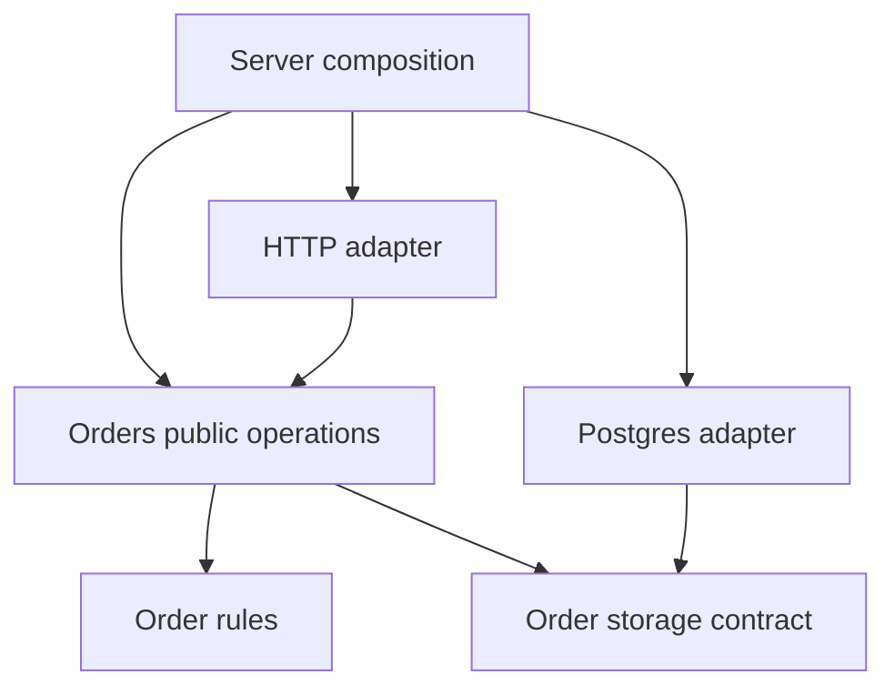

# Codebase architecture standard

**Status:** Proposed baseline for adoption. **Date:** 2026-11-22.  
**Scope:** Keeping an application understandable and changeable as its features, code and contributors grow.

This document proposes working rules and verification criteria. It does not claim that a repository already follows them, and it does not supersede accepted architecture decisions. Adoption should map these rules onto the existing project, identify exceptions, and introduce checks in stages. Cross-repository ownership, packaging and compatibility are covered in [the multi-repository standard](./multi-repository-standard.md).

“Required” below means required **after the rule is adopted for the relevant scope**. “Default” means the starting choice unless a documented reason supports another choice. “Conditional” means a mechanism introduced when the application needs it. These are practical recommendations synthesized from the research, not a claim that one directory layout or architectural style is universally correct.

## Goals and tradeoffs

An ordinary feature change should have a clear home, affect a limited set of responsibilities, and be verifiable without understanding the entire application. Contributors should be able to discover an owner, public contract, tests and relevant decisions before changing a module.

Prefer understandable boundaries over the smallest possible files. Prefer a few meaningful abstractions over layers that forward every call unchanged. Preserve the ability to change boundaries as the product becomes better understood. Additional interfaces, packages and tools have maintenance costs and should solve an identifiable problem.

## Rules

### A01 — Group cohesive responsibilities

**Required:** Give each module a stated responsibility and place the logic governing that responsibility together. Decide boundaries by what must be understood and changed together, including invariants and data ownership.

**Default:** Organize growing product code by capability, such as orders or identity, with technical subdivisions inside the capability where useful. A module can contain several features. Do not create a module for every screen or function.

This follows Parnas's information-hiding argument: concealing changeable decisions can keep their effects local. [Original paper](https://ckrybus.com/static/papers/decomposing_systems_into_modules_1972.pdf)

### A02 — Expose deliberate public APIs

**Required:** Consumers use the owning module's public operations and contracts. They must not reach into private implementation files, internal state or another module's storage representation. Document exported behavior, errors and constraints that callers rely on.

**Default:** Keep the public surface small. Exporting everything through `index.ts` or `public.ts` does not create encapsulation. Enforce supported import paths using package exports, language visibility, dependency rules or an equivalent check. Check dynamic and aliased imports where the chosen tooling supports them; record blind spots.

### A03 — Keep module import dependencies acyclic

**Required:** Define the application module graph and reject circular source-code dependencies between its modules. Module A must not import module B when B already depends on A, directly or transitively.

Resolve a cycle by moving a shared contract to its proper owner, introducing orchestration, or reconsidering the boundary. Do not break it merely by hiding imports behind runtime lookup. This rule concerns source dependencies; it does not prohibit callbacks or bidirectional protocol conversations.

Spring Modulith illustrates automated checks for cycles, private access and allowed dependencies. The mechanism is stack-specific; the verification principle is reusable. [Official documentation](https://docs.spring.io/spring-modulith/reference/verification.html)

### A04 — Separate product decisions from external effects when useful

**Required:** Make the location of product rules explicit; avoid independently reimplementing the same rule in routes, screens and jobs.

**Default:** Keep substantial product decisions callable without an HTTP request, rendered screen or live database. Adapters translate external interactions; application operations coordinate work; product functions evaluate rules. Introduce a port where substituting an external dependency improves testing or isolates meaningful variability. Simple operations need not acquire empty layers or one-method wrappers.

Cockburn's pattern emphasizes application independence from external technologies, without prescribing six ports or a fixed layer count. [Original article](https://alistair.cockburn.us/hexagonal-architecture)

### A05 — Enforce browser, server and trust boundaries

**Required:** Browser code must not import server-only implementations, credentials or privileged capabilities. Use the framework's supported separation and build checks, supplemented by import restrictions where necessary. A filename convention alone is insufficient unless tooling enforces it.

Validate untrusted runtime inputs at their entry boundaries. Static types describe assumptions; they do not establish that received JSON, form values or external responses satisfy them. Keep authorization in the server operation that protects the resource, even when the UI hides unavailable actions. Return intentional response shapes rather than exposing internal objects by convenience.

### A06 — Give data and invariants an owner

**Required:** Identify which module controls each product invariant and which code may mutate its data. Express necessary persistence constraints and transaction boundaries explicitly. Another module must not bypass the owning operation through direct table writes.

**Default:** Keep persistence-specific shapes within storage code when they differ meaningfully from application concepts. Map at the boundary when nullability, naming, precision, visibility or lifecycle differs. Reusing an appropriate shape is acceptable; do not create duplicate request, domain and database classes solely to satisfy a diagram. Migrations belong with the schema owner and its release process.

### A07 — Share code with a clear purpose

**Required:** Every shared module has a defined purpose, an owner and documented consumers. Product-specific decisions remain with the product capability that owns them.

**Default:** Extract shared code after actual consumers demonstrate a stable common responsibility. Avoid an unrestricted `utils`, `common` or `services` directory that accumulates unrelated behavior. Small local duplication can be preferable while requirements differ or remain uncertain. Split a shared module when its consumers repeatedly need unrelated changes or incompatible assumptions; do not build a generic framework for hypothetical reuse.

Infrequent change alone does not justify a separate repository. Require a clear responsibility, useful public contract, ownership and an identifiable consumer benefit. For web and future mobile applications, share portable rules and data contracts where practical; preserve platform-specific interfaces and adapters. See [Shared platform and automatic adoption](./shared-platform-and-automation.md).

### A08 — Test observable behavior and important boundaries

**Required:** Changes provide verification appropriate to their risk: product-rule tests, integration checks for persistence or external adapters, and end-to-end coverage for critical user journeys as applicable. A bug fix should reproduce the failure when a meaningful regression test is practical.

Tests should describe outcomes and contracts, not mirror every internal function or assert incidental call ordering. Test doubles complement checks against real integration behavior. Refactor in small steps while preserving a working baseline; Fowler explains why frequent testing supports controlled structural change. [Original article](https://martinfowler.com/distributedComputing/refactoring.pdf)

### A09 — Keep verification repeatable

**Required:** Document supported tool versions and a standard local verification command. CI invokes the same underlying checks. Dependency changes update the appropriate lock or immutable reference and receive verification relevant to affected consumers.

**Default:** Keep fast checks early and separate slower integration suites where this improves feedback. Track confusing failures, flaky checks and unnecessary setup as maintenance work. There is no universal maximum file length, number of layers, coverage percentage or module count in this standard. Projects may set measured budgets with a stated purpose.

### A10 — Maintain the design as the code changes

**Required:** Record responsibility, public API, allowed dependencies, data ownership and verification instructions for significant modules. Keep examples and architectural explanations aligned with the implementation. Record consequential decisions and their tradeoffs in ADRs; retain historical decisions and mark superseded ones explicitly.

Adopt incrementally. Each exception identifies the rule, affected scope, reason, consequences and a review trigger or date. An exception must be discoverable beside the relevant guidance. Do not introduce a new review committee or approval role merely to apply this standard.

## File organization and placement

The following is an illustrative TypeScript layout. Framework-required routing, generated code and language conventions take precedence. Preserve the responsibilities even when the names differ.

```text
src/
  client/
    orders/                    # screens, state and browser interaction
  server/
    composition/               # construct and connect implementations
    transport/http/            # parse requests; invoke operations
    modules/orders/
      public.ts                # supported cross-module exports
      place-order.ts           # application operation
      pricing.ts               # product rules
      pricing.test.ts
      order-store.ts           # storage capability required by orders
      adapters/
        postgres-order-store.ts
    platform/                  # purposeful server facilities
  shared/                      # deliberate browser-safe shared code
migrations/                    # owned schema changes
tests/integration/             # real adapters and multi-module behavior
tests/e2e/                     # critical user journeys
docs/architecture/             # module map, boundaries and decisions
```

| Kind of change | Placement and responsibility |
| --- | --- |
| Product decision | Owning capability's rules or operation; not duplicated in a route |
| Request validation | Transport boundary for syntax; operation for product invariants |
| Authorization | Protected server operation or a reliably enforced server gate |
| External API or database access | Adapter owned by the capability or a narrowly defined platform facility |
| Browser interaction | Client feature; calls an intentional server interface |
| Shared type or helper | Owning module first; shared location only for an established common contract |
| Unit test | Beside the behavior by default; separate when tooling or packaging requires it |
| Integration test | Beside its adapter or in the designated integration suite |
| Generated file | Marked generated directory; record generator and input ownership |

An `adapters/` folder is conditional. A pure function may need only its implementation and test. Keep framework conventions recognizable rather than reproducing this tree mechanically.

## Example dependency direction

Arrows mean **source imports**, not execution order or network traffic. The storage contract belongs to the application capability. Composition connects implementations without becoming product logic.



At runtime an operation may call the injected storage implementation. That does not require its source to import the Postgres adapter. This pattern is useful when separation earns its cost; it is not mandatory for every function.

## Acceptance evidence after adoption

Checks must run on the change being reviewed. A successful check proves only the property it examines; a clean dependency diagram does not prove correct product behavior.

| Rules | Automated evidence where applicable | Manual evidence |
| --- | --- | --- |
| A01, A06, A07 | Declared ownership and schema checks where supported | Cohesive change, clear invariant owner, justified sharing |
| A02, A03 | Forbidden-import, public-entry and cycle checks | Public API semantics; documented tooling blind spots |
| A04 | Product tests independent of unnecessary external systems | Abstraction solves actual variability or testability need |
| A05 | Browser build/import checks; runtime validation and authorization tests | Trust boundaries, response disclosure and policy review |
| A08, A09 | Relevant tests, typecheck and lint through documented commands | Tests exercise meaningful failure modes |
| A10 | Links and generated-document checks where available | Explanation matches behavior; decisions and exceptions current |

During rollout, first document the existing boundaries, then select high-value checks and fix or explicitly baseline existing violations. Apply adopted checks to new work and reduce exceptions deliberately. Measure progress through easier navigation, more localized changes and less repeated coordination, rather than folder counts or conformity to this example.
