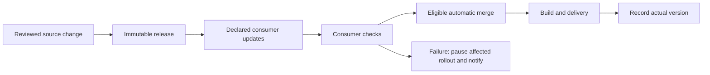

# Shared platform and automatic propagation

**Status:** User goals captured; implementation proposed. **Date:** 2026-11-22.  
This document enables no automation and moves no repositories. It complements the [multi-repository standard](./multi-repository-standard.md) and [adoption plan](./adoption-plan.md).

The intended outcome is one authoritative owner for shared capabilities, with compatible changes reaching supported consumers automatically and failures remaining visible. The immediate examples are brand, protocol definitions and developer tooling. Web, mobile and presentation should consume those contracts without maintaining competing copies.

The [repository-boundaries proposal](repository-boundaries-and-contracts.md) develops the shared-backend direction: web and mobile consume authenticated product APIs, while the backend owns server operations and adapters. It also separates deployment orchestration from reusable developer tooling.

## Extract reusable responsibilities, not merely quiet code

Extract from the existing application when a capability has a coherent purpose, a useful public contract, an accountable owner and credible consumers. Infrequent change alone is insufficient: stable code may still depend deeply on the application's database, permissions or navigation.

Before extraction, identify dependencies and demonstrate the boundary inside the current application. Separate portable decisions from platform adapters. Establish behavioral tests, compatibility expectations and a release route before switching consumers. Prefer one proven extraction over a speculative collection of packages.

Useful candidates include platform-neutral brand tokens, protocol definitions and rules demonstrably shared by the existing application and a future client. Applications continue to own screens, navigation, platform interaction and product orchestration. Server authorization and privileged operations remain server responsibilities. Sharing types does not move those checks into a mobile client.

Avoid a universal core that every application must adopt wholesale. A future mobile application should be able to use the relevant contracts without importing a web framework, browser environment or server implementation. A shared runtime can justify additional component reuse, but it is a separate technology decision.

## Brand is a semantic contract

The proposed `brand` authority owns semantic tokens, their meaning, supported themes, fonts, icons and approved assets. It produces versioned consumer artifacts such as CSS variables, structured JSON and generated native-platform resources. Those outputs share one source; generated artifacts are not independently edited.

Consumers use semantic roles such as primary action, subdued text and content spacing rather than copying literal values. Web, native and image-rendering adapters map those roles into their own rendering systems. Interactive components remain platform-specific unless a common runtime and component contract are deliberately selected.

**Consumption invariant upon adoption:** shared brand decisions come through generated artifacts or public token exports, with no maintained copies in consumers. Use scoped lint rules and generated-output checks to detect copied or hardcoded brand values where feasible. Existing components must actually reference the semantic roles for updates to affect them.

A changed token value can update existing uses after the consumer receives the release. Adding a token does not automatically make any screen use it. Removing or changing the meaning of a token, replacing an asset incompatibly, or changing typography metrics can require deliberate consumer migration. A patch label alone does not establish visual compatibility.

An incompatible JSON contract requires a migration. Automation must reject and report unsupported shapes; it cannot safely invent component behavior or adapt arbitrary application code.

Brand verification should include generated-output consistency, asset integrity and licensing, semantic contract checks, and representative consumer rendering checks. Maintain approved visual fixtures for web, mobile and presentation; baseline changes require the review policy appropriate to the change.

An intentional brand change will alter screenshots. Its intended visual effect should be approved with the brand change and checked against consumer layout, readability and interaction invariants. Do not require a fresh manual design decision in every consumer for the same approved value change, or blindly regenerate baselines to hide an unexpected regression.

## Lexicons are the authoritative protocol definitions

Use one authoring authority and reproducible consumer artifacts, with any published schemas derived from the same recorded revision. Reconcile the existing snapshot transition once; then enforce the stable compatibility baseline.

For existing NSIDs, new fields must be optional; field names, types and size/length limits remain stable. Retain deprecated fields. Larger breaking designs require a new NSID. Readers must tolerate permitted extension fields, and record updates must avoid discarding them. These are protocol compatibility obligations, not a promise that every addition needs no consumer work. [AT Protocol Lexicon specification](https://atproto.com/specs/lexicon#lexicon-evolution)

Add application checks for preserved meanings, defaults and representative reader/writer behavior. Keep strict authored-example lint separate from protocol validation. New schema support does not automatically implement a corresponding editor control or rendering feature.

## Automatic delivery means a complete lifecycle

Recommend the following release-driven process. It selects exact versions automatically rather than making applications depend on mutable `latest` content.

1. Review and merge the source change. Validate its contract and publish an immutable release with source revision, artifacts and compatibility classification.
2. Discover consumers from an explicit registry of dependencies, supported release lines, verification commands and rollout policy. An organization membership alone does not enroll a repository.
3. Create or update dependency branches and pull requests. Advance dependent packages in dependency order: for example, brand first, then presentation, then applications consuming the newly released presentation package. Independent consumers can proceed concurrently.
4. Run consumer contract, build and relevant behavioral and visual checks against the candidate pins. Compatibility is a verified outcome, not only a version-number comparison.
5. Automatically merge eligible changes under a preauthorized policy defining repositories, dependency types, supported ranges, required checks and excluded change classes. Breaking migrations, unexpected visual differences and permission changes follow deliberate review.
6. Build and release or deploy the consumer through its normal delivery path. Record completion only after the required destination step succeeds.



A failure pauses the affected update and downstream dependents; unrelated verified updates need not stop. Notify the responsible owner with the failed step, affected consumers and recovery action. Retries must be bounded and safe to repeat. Preserve the last known-good delivery, and use explicit rollback or forward-fix releases instead of moving an existing release identifier.

Maintain expected, proposed, merged, built and deployed versions separately. Report consumers that are blocked or behind policy, including the reason and elapsed time. A green source release or merged dependency update is not proof that every product has changed.

Reconcile the registry with actual manifests, lockfiles and workflow references so undeclared consumers are detected. Exercise a complete bot-created update during rollout: its checks, merge event and delivery must actually execute. A changed central reference does not itself trigger every consumer workflow.

## Mobile delivery has a separate boundary

For bundled tokens, fonts and assets, an installed mobile application changes only when a new application build reaches that device. Publishing brand and merging the mobile dependency update can be automatic; distribution, installation and older supported app versions remain distinct states.

Runtime-delivered appearance configuration is an optional architecture decision, not an assumption. If introduced, constrain it to a validated, versioned schema with supported values, cached fallback and rollback behavior. Do not deliver executable behavior through that channel. Record compatibility and store-distribution constraints for the chosen platforms before adopting it.

## Developer tooling as a proposed authority

The proposed destination is `developer-tooling` for CI implementations, reusable actions, workflow helpers and their tests. Keep `.github` focused on organization community metadata, repository discovery and policy entry points. Existing automation work, including [`.github` PR #6](https://github.com/unset-sh/.github/pull/6), must be reconciled through a destination decision before relocation; this document does not silently supersede it.

An illustrative layout is:

```text
developer-tooling/
  .github/workflows/
    check-node.yml
    publish-package.yml
    docs-site.yml
    mobile-check.yml
  actions/                     # reusable implementation steps
  packages/                    # versioned tooling libraries
  repositories/
    docs/                      # consumer-specific helpers and fixtures
    brand/
    mobile/
  tests/
  docs/
```

Reusable workflow YAML must live directly in `.github/workflows/`; nested workflow directories are unsupported. Workflows declare `workflow_call` and callers reference them at the job level. Full commit references provide an immutable implementation selection. [GitHub reusable-workflow documentation](https://docs.github.com/en/actions/how-tos/reuse-automations/reuse-workflows)

Consumers retain small workflow callers defining events, permissions and declared inputs. Environment selection is passed through a documented interface and applied in supported implementation jobs; repository environments and protection settings remain consumer-owned. Build and test commands that define the product belong with the product. Central tooling coordinates them rather than copying their implementation.

Fetch supporting helpers from the same immutable tooling revision as the selected implementation. Do not assume that invoking a remote workflow automatically places its repository's helper files in the consumer checkout. Test the real caller interface as well as isolated helper functions.

Propagate tooling releases through the same consumer-update lifecycle. A release-driven updater supports prompt fan-out; scheduled Dependabot is another option for updating action and reusable-workflow references. Dependabot opens update pull requests on its configured schedule; automatic merging requires a separate policy and passing checks. [GitHub Dependabot documentation](https://docs.github.com/en/code-security/how-tos/secure-your-supply-chain/secure-your-dependencies/auto-update-actions)

Prefer invoking versioned implementations over copying boilerplate. Where platform constraints require generated callers or configuration, mark them generated and record the source revision, generator and content hash. Check for drift and update through automation. Centralization reduces duplicated implementation; it does not remove consumer-specific triggers, credentials, settings or delivery responsibilities.
